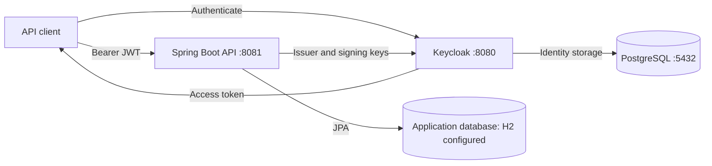
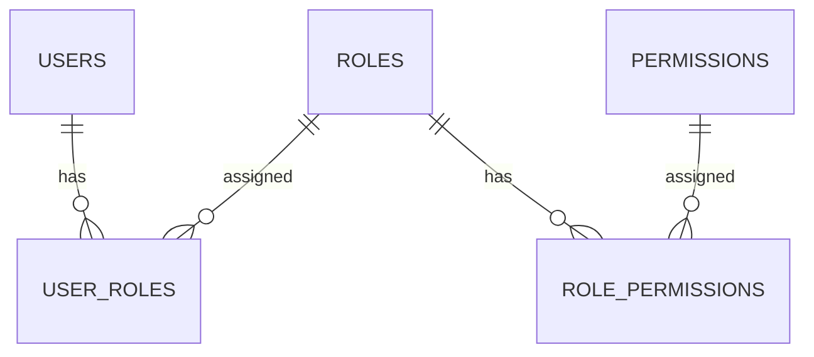

# Secure Enterprise IAM Platform

A Spring Boot REST API for managing users, roles, and permissions, protected by Keycloak-issued JWT access tokens. The repository currently contains the backend and Docker Compose infrastructure for Keycloak and its PostgreSQL database. It does not contain a frontend.

> **Development status:** Keycloak integration exists in the code, but end-to-end operation has not been verified. The backend configuration references H2 without declaring its driver dependency. Local user passwords are currently stored without hashing. Resolve these issues before using real credentials or deploying the platform.

## Architecture



Keycloak owns authentication. The API validates JWTs and converts `realm_access.roles` into Spring Security authorities with a `ROLE_` prefix and uppercase names. For example, realm role `admin` becomes `ROLE_ADMIN`. Token scopes are also converted using Spring's default converter.

The application database stores its own users, roles, and permissions. These records are **not synchronized with Keycloak**: creating an API user does not create a Keycloak identity, assigning a database role does not change a JWT, and disabling an API user does not disable a Keycloak account or revoke a token. Authorization currently uses token realm roles, not the permissions stored in the application database.

## Implemented capabilities

- Create, list, read, update, and delete users, roles, and permissions.
- Assign and remove roles from users and permissions from roles.
- Enable and disable local user records.
- Enforce `ADMIN` for mutations and `ADMIN` or `USER` for reads.
- Validate request fields and return structured business and validation errors.
- Generate UUID identifiers and creation/update timestamps through JPA auditing.
- Describe the API with OpenAPI and Swagger UI; expose a public health endpoint.

Email verification and last-login recording exist as service methods but have no controller endpoints or authentication-event integration. Auditing records timestamps, not a full security event history.

## Stack and repository map

Versions below are the values declared in the repository, not a statement of dependency compatibility.

| Component | Declaration / purpose |
| --- | --- |
| Java | 17 |
| Spring Boot | 4.0.7; Web MVC, Security, OAuth2 Resource Server, Data JPA, Validation, Actuator |
| Springdoc | 2.8.5; OpenAPI and Swagger UI |
| Keycloak | Docker image `quay.io/keycloak/keycloak:25.0.0` |
| PostgreSQL | Docker image `postgres:16-alpine`; used by Keycloak |
| Maven | Wrapper distribution 3.9.16 |
| Lombok | DTO/entity accessors, builders, constructor injection, logging |

```text
.
├── .env.example                 # Compose variable template (no real credentials)
├── docker-compose.yml           # Keycloak + PostgreSQL; backend runs separately
└── iam-backend/
    ├── pom.xml                  # Dependencies and Maven plugins
    ├── mvnw / mvnw.cmd          # Maven wrapper for Unix / Windows
    └── src/
        ├── main/resources/application.yaml
        ├── main/java/com/samir/iam/
        │   ├── IamBackendApplication.java
        │   ├── audit/           # Shared UUID and timestamp fields
        │   ├── config/          # JPA auditing and OpenAPI bearer scheme
        │   ├── controller/      # HTTP routes and method authorization
        │   ├── dto/             # Validated requests and public response models
        │   ├── entity/          # User, Role, Permission and join tables
        │   ├── exception/       # Business exceptions and shared error handler
        │   ├── repository/      # JPA persistence and lookup methods
        │   ├── security/        # Stateless JWT filter chain and role converter
        │   ├── service/         # Business interfaces and transactional implementations
        │   └── util/mapper/     # Explicit entity / DTO mapping
        └── test/                # One Spring context-load test
```

The Maven wrapper configuration lives in `.mvn/wrapper/maven-wrapper.properties`. Git ignore files exclude build output, logs, IDE metadata, and local environment files. The tracked `.idea/.gitignore` is IDE housekeeping.

## Data model



Every entity inherits `id`, `createdAt`, and `updatedAt`. Users have unique username/email, password, profile names, enabled/locked/verified flags, and a last-login timestamp. Roles and permissions have unique names and descriptions. User responses include nested roles and permissions, but exclude passwords.

The service layer checks duplicate usernames/emails on user creation and duplicate role/permission names. Relationship assignment checks for missing resources and repeated assignments. Update paths have limitations described below.

## Local setup

Prerequisites: JDK 17, Docker with a running engine and Compose, and network access to resolve Maven dependencies and container images. Ports 5432, 8080, and 8081 must be available.

### 1. Configure the infrastructure

From the repository root, in PowerShell:

```powershell
Copy-Item .env.example .env
# Edit .env and replace both password placeholders before starting services.
docker compose up -d
docker compose ps
docker compose logs keycloak
```

The `.env` file is ignored by Git. Keep `KC_DB_PASSWORD` consistent with `POSTGRES_PASSWORD`. The default database in the template is `keycloak_db`; its data persists in the Compose `postgres_data` volume. Compose does not launch or configure the backend database.

The checked-in Compose file uses `start-dev`, exposes PostgreSQL on the host, and sets `POSTGRES_HOST_AUTH_METHOD: trust`. This is a development configuration; password placeholders alone do not harden the database while trust authentication is enabled.

### 2. Configure Keycloak

Open `http://localhost:8080/admin/` and sign in using the admin credentials set in `.env`.

1. Create a realm named `iam-realm`, matching `application.yaml`.
2. Create realm roles `ADMIN` and `USER` (the converter also accepts lowercase equivalents).
3. Configure an OpenID Connect client for your API testing application and its chosen login flow. For an interactive client, use Authorization Code with PKCE and explicit local redirect URIs.
4. Create test identities and assign the appropriate realm roles.
5. Obtain an access token through that client and check that it contains the expected issuer and `realm_access.roles` claim.

No realm export, preconfigured client, seeded user, client secret, or automated realm import is included. These steps are manual prerequisites. Do not confuse the Keycloak administrator account with an application user in `iam-realm`.

### 3. Resolve the backend database configuration

The current YAML selects `org.h2.Driver` and an in-memory H2 URL, but `pom.xml` only declares the PostgreSQL runtime driver. Choose and implement one of these paths before expecting startup to succeed:

- Add an H2 runtime dependency (`com.h2database:h2`) to use the existing development configuration. Its in-memory data is lost when the JVM exits.
- Provision a separate application database and override the datasource URL, credentials, driver, and Hibernate dialect for PostgreSQL. Avoid sharing Keycloak's identity schema with application tables.

The root `.env` is consumed by Compose; Spring Boot does not automatically load it into the separately launched backend. Supply backend overrides through environment variables or Spring configuration.

### 4. Build and start the backend

```powershell
Set-Location iam-backend
.\mvnw.cmd test
.\mvnw.cmd spring-boot:run
```

On Linux/macOS use `./mvnw test` and `./mvnw spring-boot:run`.

| URL | Purpose |
| --- | --- |
| `http://localhost:8080/admin/` | Keycloak admin console |
| `http://localhost:8080/realms/iam-realm/.well-known/openid-configuration` | Realm discovery |
| `http://localhost:8081/swagger-ui/index.html` | API documentation (intended route; runtime not verified) |
| `http://localhost:8081/v3/api-docs` | OpenAPI JSON |
| `http://localhost:8081/actuator/health` | Public backend health |

## API reference

All business routes require `Authorization: Bearer <access-token>`. Identifiers are UUIDs. Lists are currently unpaginated.

| Method | Route | Required realm role | Success |
| --- | --- | --- | --- |
| POST | `/api/v1/users` | ADMIN | 201 |
| GET | `/api/v1/users` or `/api/v1/users/{id}` | ADMIN or USER | 200 |
| PUT | `/api/v1/users/{id}` | ADMIN | 200 |
| DELETE | `/api/v1/users/{id}` | ADMIN | 204 |
| PUT | `/api/v1/users/{id}/enable` or `/{id}/disable` | ADMIN | 204 |
| PUT / DELETE | `/api/v1/users/{id}/roles/{roleId}` | ADMIN | 200 |
| POST | `/api/v1/roles` | ADMIN | 201 |
| GET | `/api/v1/roles` or `/api/v1/roles/{id}` | ADMIN or USER | 200 |
| PUT | `/api/v1/roles/{id}` | ADMIN | 200 |
| DELETE | `/api/v1/roles/{id}` | ADMIN | 204 |
| PUT / DELETE | `/api/v1/roles/{id}/permissions/{permissionId}` | ADMIN | 200 |
| POST | `/api/v1/permissions` | ADMIN | 201 |
| GET | `/api/v1/permissions` or `/api/v1/permissions/{id}` | ADMIN or USER | 200 |
| PUT | `/api/v1/permissions/{id}` | ADMIN | 200 |
| DELETE | `/api/v1/permissions/{id}` | ADMIN | 204 |

Example authenticated read in PowerShell (use a token acquired from your configured client):

```powershell
$accessToken = Read-Host 'Paste a development access token'
$headers = @{ Authorization = "Bearer $accessToken" }
Invoke-RestMethod http://localhost:8081/api/v1/users -Headers $headers
```

Example permission request body:

```json
{
  "name": "READ_REPORTS",
  "description": "Read reporting data"
}
```

Role requests accept `name`, `description`, and optional `permissionIds`. User requests require `username` (3–50 characters), a valid `email`, and `password` (at least 8 characters), plus optional `firstName`, `lastName`, and `roleIds`. Role/permission names must be 3–50 characters. Use synthetic data until password handling is fixed.

User PUT currently validates the full user request but only changes first name, last name, and optionally role assignments: supplied username, email, and password do not update those fields. Null relationship ID sets preserve existing assignments on update; empty sets clear them.

Business errors use status 400, missing resources 404, duplicates 409, and validation errors 400. The response includes `status`, `error`, `message`, `timestamp`, `path`, and optional `validationErrors`. Authentication failures are handled by Spring Security. The broad controller exception handler needs explicit access-denied handling to avoid turning method authorization failures into generic 500 responses.

## Review findings and remaining work

This is an IAM backend foundation, with security and operational work remaining before production use.

| Priority | Finding | Relevant source |
| --- | --- | --- |
| Critical | Passwords are copied directly to local user entities without hashing; no Keycloak provisioning replaces this path. | `UserMapper`, `UserServiceImpl` |
| High | Local enabled/locked flags and role/permission assignments do not participate in JWT authorization. Decide whether Keycloak or the application is authoritative and implement the bridge. | `SecurityConfig`, `JwtAuthenticationConverter`, services |
| High | H2 is configured but its driver dependency is absent. | `application.yaml`, `pom.xml` |
| High | Development infrastructure uses PostgreSQL trust authentication and Keycloak development mode. Configure authenticated DB access, restricted networking, HTTPS, and production Keycloak settings. | `docker-compose.yml` |
| High | JWT audience validation is not explicitly configured; only realm roles, not client roles, are extracted. | Security package, YAML |
| Medium | Wildcard CORS, security DEBUG logging, SQL logging, and automatic schema updates need environment-specific policies. | Security configuration, YAML |
| Medium | Generic exception handling can obscure access-denied, malformed-input, and database-constraint errors. | `GlobalExceptionHandler` |
| Medium | User/role updates load referenced IDs without checking that every ID exists; deletes do not fully handle assigned relationships. | Service implementations |
| Medium | Spring Boot 4.0.7 and Springdoc 2.8.5 compatibility requires validation; Swagger availability is not established by source inspection. | `pom.xml` |
| Medium | Only a context-load test exists; no behavioral authorization, JWT conversion, validation, or relationship tests are present. | `src/test` |
| Planned | Realm bootstrap/export, identity synchronization, token-aware account disabling, database migrations, event audit history, pagination, CI, backend containerization, and frontend. | Not implemented in this repository |

## Verification and screenshots

Review performed on 2026-11-12 against the cloned repository. Java 17.0.18 is installed. Docker CLI is installed, but the Docker engine was unavailable, including when checked outside the restricted execution context. Therefore Keycloak could not be launched for screenshots during this review.

The Maven test attempt and its final result are recorded in [the project review](docs/PROJECT_REVIEW.md). A test command invocation alone is not evidence that the application runs.

No runtime screenshots are included because no running UI was verified. Once startup issues are resolved, useful captures are the Keycloak realm roles page, a test user's role mappings, Swagger's Users/Roles/Permissions groups, and successful/denied authenticated requests. Store sanitized captures in `docs/screenshots/`; exclude passwords, client secrets, tokens, and personal data. The architecture and data diagrams above describe the code and are not screenshots.
